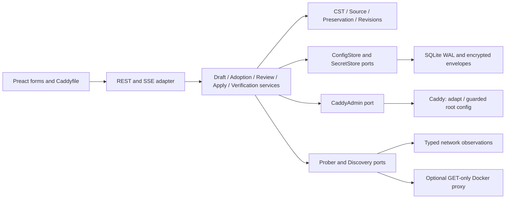
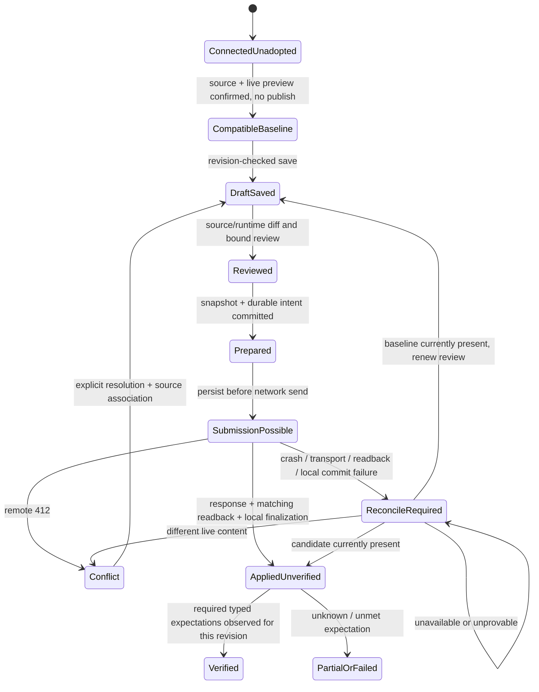

# Architecture Spine — Caddy Orchestrator

## Design Paradigm

**Hexagonal Architecture (Ports and Adapters) with a staged draft pipeline.** Domain rules own editable Caddyfile/CST, source identity, preservation mappings, review binding and configuration revisions. Application services orchestrate storage, target adaptation, guarded publication and observations through ports. SQLite/Caddy/Docker/network/HTTP are adapters. The frontend uses shared persisted projections plus separate unsaved input buffers.

This is the approved future build substrate, revised under [P01–P13](../../sprint-change-proposal-2026-10-17.md). [CLAUDE.md](../../../../CLAUDE.md) describes current scoped-route behavior. Stable public IDs remain AD-1–AD-11. Earlier memlog-only numbers are provenance, not additional active decisions. [Configuration contracts](configuration-contracts.md) are normative for shared records, APIs, mapping, supported forms and migration. Final records a completed planning handoff, not implemented or runtime-certified behavior.

## Layer Boundaries

Domain packages use standard-library types only; no Gin/SQLite/Caddy transport dependencies. Application services depend on domain and ports. Adapters implement ports and inbound use cases. The HTTP layer cannot bypass the application apply coordinator. Legacy packages remain the current baseline while adapters are introduced use case by use case. Exactly one write mode is enforced per target; old CRUD cannot mutate a root-adopted target. A broad directory rewrite is not a prerequisite story.

## Invariants & Rules

### AD-1 — Caddyfile source, lossless CST and complete supported forms [ADOPTED]

- **Binds:** source/CST domain, form codecs, editor, draft store.
- **Prevents:** dropped source, incompatible editor projections and transient route identity.
- **Rule:** Canonical editable source is a protected Caddyfile bundle with immutable dependency provenance. Parsing never changes bytes. An explicit save assigns missing comment IDs and records the delta; duplicate IDs block save. Sites and route nodes have stable separate identities. Immutable source bundle identity includes enabled-node and node-identity maps; recovery restores those historical maps. Disabled nodes retain source/identity and are omitted only from transient compilation. Forms and editor share the same candidate; invalid text is durably protected while unsafe switching blocks. Every setting in a supported build has a dedicated or structured directive form descriptor; missing form coverage is an unfinished capability, never a permanent editor-only substitute. Exact source/runtime compatibility boundaries are specified in companion X1/X3.

### AD-2 — Explicit root ownership and path preservation [ADOPTED]

- **Binds:** adoption, source acquisition, compiler mapping, diff and root candidate composition.
- **Prevents:** implicit rewrites and loss of unknown nested or root configuration.
- **Rule:** Adoption captures the live root and associates supplied/read-only source with it; it neither publishes nor assumes remote filesystem access. A preview binds target generation, root ETag, source/build/dependency identity and preservation manifest; changed live preview rejects confirmation. For JSON-only targets require source or a tested equivalence-proving converter, never invented original comments/imports. Compose by proven path deltas from generated baseline to candidate onto captured live root; preserve unmapped raw paths and array order. Mixed generated/preserved arrays are indivisible and blocked from modification without complete mapping. Root `logging`/`storage` and `apps.pki`, other servers/listeners and nested routes all participate. Overlap or unexplained differences blocks the affected publication. Full-config intent is retained; compatibility gaps are visible. Target connection descriptors are immutable and retained by attempts/history; reconciliation never uses a new global URL. Target change detaches old drafts/history and requires renewed adoption without silently erasing work.

### AD-3 — Reviewed staged publication with durable attempts [ADOPTED]

- **Binds:** draft/review/apply/restore coordinator, database transactions and target adapter.
- **Prevents:** publication on draft save, unreviewed writes and loss of crash recovery evidence.
- **Rule:** UI mutations persist only to a revisioned draft. Review binds target/generation, draft revision, exact candidate, source/build/dependencies, preservation manifest and root ETag. Before any configuration mutation, recheck the reviewed draft revision and acquire a durable target/draft lock rejecting saves and connection changes until resolution. One transaction commits the pre-write recovery point and protected baseline/candidate attempt record; mark submission possible durably before sending. Failed local preparation sends nothing. Apply and restore use one root `POST /config/` with JSON and exact reviewed `If-Match`; never fallback to `/load`. Read back through the captured immutable connection descriptor and finalize only the captured draft revision/attempt atomically; unexpected CAS mismatch stays unresolved. No remote/local transaction or automatic rollback is promised. Protocol, API fields and record shapes are fixed in companion P02/P04/X2.

### AD-4 — Revision-bound observations with honest limits [ADOPTED]

- **Binds:** verification jobs/results, prober port, browser checks and status UI.
- **Prevents:** inferred failure causes, universal success and stale results for newer config.
- **Rule:** Separate config acceptance, enabled state, DNS/TCP/TLS, direct upstream and published-service observations. Every result carries target/generation/applied revision/expectation version, method, time and vantage; old results remain historical and cannot verify current revision. Typed expectations include scheme/host/SNI/port/path, allowed status, redirect Location and trust policy. HTTP 502/403 alone identifies no unique cause. Browser CORS/CSP/opaque/mixed-content/trust failures yield unknown/unavailable where required evidence is inaccessible. CSP changes allow only explicitly selected origins. Default per-check deadline is 10s; transient retries at 5/15s, evidence expires after five minutes or revision change; retry never publishes. Manager trust does not prove client trust. Unmet required expectations remain applied/unverified or partially verified.

### AD-5 — Protected sources and immutable secret versions [ADOPTED]

- **Binds:** adoption/migration, draft buffers, secret store, adapters, recovery and exports.
- **Prevents:** plaintext source archives, masked-value corruption and unrecoverable historical credentials.
- **Rule:** Initialize AES-GCM-256 storage/key before importing any source/runtime/legacy secret-bearing data. Encrypt exact bundles/runtime originals/attempt payloads and unknown opaque blocks; known secret fields use immutable version references. Keep/replace/remove are distinct API actions; masks are display-only. Materialize credentials only in memory for adaptation/publication. Protect against error/log/export leakage, including remote errors and unknown blocks. Rotate by adding a version; retain referenced historical versions. Missing key/version blocks operation. Ordinary APIs/editor expose safe reference tokens or hide unclassified opaque content. Keys come from `ENCRYPTION_KEY` or protected `/app/data/.key`; key loss is unrecoverable absent backup.

### AD-6 — Optional read-only Docker discovery [ADOPTED]

- **Binds:** discovery adapter and upstream suggestion forms.
- **Prevents:** Docker lifecycle coupling and unavailable discovery blocking manual input.
- **Rule:** Only configured GET-only proxy access to container metadata; no container mutation or automatic publication. A read-only raw socket mount does not enforce API read-only permissions; recommend a restricted proxy. Absent/denied Docker returns an empty result plus discovery availability state. Manual IP/name/port remains functional. Suggestions identify their network context; discovery proves neither Caddy reachability nor browser access.

### AD-7 — Shared persisted state with revision-checked sessions [ADOPTED]

- **Binds:** draft API, SQLite revision updates, Preact Signals and SSE.
- **Prevents:** desktop/phone stale saves and events overwriting unsaved input.
- **Rule:** One active persisted draft per current target generation. Mutations require expected revision; atomic mismatch returns application 409 before saving. Centralized Signals owns persisted projections; local unsaved buffers remain independent and protected. SSE includes event ID/target/generation/revision; gaps/reconnect fetch authoritative state and reconcile local input explicitly. Never replay offline writes silently. Review invalidates on revision/generation/dependency change.

### AD-8 — Atomic remote precondition and three-way conflict handling [ADOPTED]

- **Binds:** target writer, diff/rebase, restore review and conflict UX.
- **Prevents:** read-before-write races and ETag-only rebases overwriting changes.
- **Rule:** A root conditional mutation uses the exact Caddy-issued root ETag; remote 412 maps to app 409. An earlier GET is not the write guard. Rebase compares baseline/live/candidate mapped deltas; ancestor/descendant overlap and ambiguous arrays require explicit resolution, compatible source association and renewed review. Discard must also acquire a valid new source association. Restore compares against the live ETag captured by its review and checks target/generation/scope. No force or unconditional retry. External writers after success remain possible; subsequent drift invalidates current observations. Supported-target compatibility includes a writer inserted between final GET and submission.

### AD-9 — Target adaptation and evidence-based build compatibility [ADOPTED]

- **Binds:** Caddy adapter, compilation, compatibility inventory and TLS provider forms.
- **Prevents:** fictitious module inventory/semantic dry-run endpoints and compiler mismatch.
- **Rule:** Target `POST /adapt` with `text/caddyfile` returns a wrapper containing `result` JSON and optional warnings. Adaptation does not provision/run the config; `validate=true` is not a semantic validation contract. `GET /config/` provides JSON/ETag, not build/module inventory. Operator-supplied version/module/image manifests supply labelled evidence; absent information stays unknown. Known missing modules block; successful adapt is narrower than full compatibility. Pin the Caddy 2.9.1 reference fixture and DNS provider build lock, with Cloudflare as first DNS-01 reference adapter. Manager bundles no Caddy binary. Complete supported settings require the X3 descriptor inventory, not a blanket plugin promise. Explicit PKI downloads retrieve/validate the root from the chain and disclose default-CA provisioning side effects.

### AD-10 — Uncertain-operation locks and external persistence [ADOPTED]

- **Binds:** attempt lifecycle, startup, readback, deployment and operational status.
- **Prevents:** blind retry after crash/acknowledgement/local-finalization failure and unproven restart claims.
- **Rule:** Every unfinished submission-possible attempt locks target mutations on restart. Transport loss, failed readback, process death or failed local finalization requires content reconciliation using persisted protected baseline/candidate. Candidate equality records candidate currently present; baseline equality preserves unapplied draft; other state is conflict; unavailable/unprovable comparison stays locked. Equality never proves historical causation. ETags are opaque and never compared to manager hashes. Companion P04 fixes structural comparison rules. External startup requires resume/equivalent and persistent config/data; API connectivity cannot prove filesystem mounts/flags. Prove restart in the reference fixture and show operator-declared prerequisites for remote targets. Admin API stays private and reachable from the manager.

### AD-11 — Scoped recovery, functional migration and complete backups [ADOPTED]

- **Binds:** recovery store/restore, schema migration and backup runbooks.
- **Prevents:** lost local-only routes, unusable historical restore and incomplete backups labelled complete.
- **Rule:** Recovery entries carry target/generation/scope/time/reason; full config and legacy route arrays remain distinct. Core storage/guarded restore precede first publication. At most 100 history entries; pin active attempt recovery and reject publication if no safely prunable capacity. Retain historical secret material as long as referenced. Versioned transactional migration preserves route payloads/IDs/order, disabled/local intent, settings/ownership and legacy snapshot scope with rollback/restart checks; never rebuild solely from live Caddy. Complete backup is consistent SQLite + key + current config/source/import/env/build/startup assets + external config/data or equivalent storage. Operator-side acquisition handles remote assets; no Docker/filesystem write access is granted. Missing pieces mean incomplete package. Restore into a clean fixture and prior-release upgrade are release gates; downgrade uses the compatible prior backup/image.

## Consistency conventions

UUIDv4 IDs; UTC RFC3339 timestamps; Problem Details errors; opaque target ETags distinct from integer draft revisions and applied revision UUIDs. SQLite WAL, foreign keys ON, busy timeout 5000ms; schema in companion X2. Basic Auth on non-loopback unless explicit override, paired credentials always, constant-time checks, mutation CSRF header and origin policy on POST/PUT/PATCH/DELETE. Private Admin API; manager UI default 3000. WCAG 2.2 AA target, 44px touch targets, 320px reflow, 200% text zoom, visible focus and text/symbol status. DESIGN owns appearance; EXPERIENCE owns interaction, with approved contract corrections.

## Stack seed

Versions below ratify existing manifests, not a latest-version recommendation. Source: `go.mod`, `mise.toml`, `web/package.json`/lock and Dockerfile. No new stack migration is authorized.

| Name | Version |
| --- | --- |
| Go | 1.25.13 |
| Gin | 1.12.0 |
| mattn/go-sqlite3 | 1.14.50 |
| Node.js | 24 |
| Preact | 10.29.8 |
| Preact Router | 4.1.2 |
| Tailwind CSS | 3.4.19 |
| Vite | 8.2.2 |
| Alpine runtime | 3.24 |
| Caddy reference target | 2.9.1 |

Preact Signals remains the chosen state mechanism but is not installed in current source. Story 1.10 must add and lock a verified compatible version; the previous unverified 2.0.1 pin is removed. Tool/harness delivery is planned, not present evidence.

## Structural seed

`internal/domain` owns source/CST/revision/preservation models; `internal/app` owns use cases; `internal/ports` defines ConfigStore, SecretStore, CaddyAdmin, NetworkProber, DockerProbe; `internal/adapters` implements transport/storage. Introduce these incrementally from the current `internal/api`, `config`, `caddy`, `storage` baseline. Frontend pages are Adoption, Routes/RouteEditor, Configuration/CaddyfileEditor, Changes and Recovery. No directory scaffolding alone completes a story.

Record relationships and API envelopes are fixed in companion X2; target→bundle/draft→review→attempt→applied revision→probe result is the common identity chain. Recovery references immutable secret versions. Restore uses the same chain and creates a new applied revision.

## Capability → architecture map

| Requirement | Governing ADs | Story consumers |
| --- | --- | --- |
| FR-1 adopt existing config | 1, 2, 5, 9 | 1.2–1.6 |
| FR-2 publish and retain | 1, 3, 8, 10 | 1.7–1.10; 2.1 |
| FR-3 supported editing/validation | 1, 6, 9 | 1.4; 2.1–2.5; 4.4 |
| FR-4 preserve full root | 1, 2, 8 | 1.4, 1.6, 1.8; 2.5 |
| FR-5 concurrent/uncertain changes | 3, 7, 8, 10 | 1.7–1.9; 3.3–3.5 |
| FR-6 honest status | 4, 7, 10 | 1.10; 5.1–5.4 |
| FR-7 diagnosis | 4, 9 | 5.1–5.5 |
| FR-8 four TLS scenarios | 1, 4, 5, 9 | 1.10; 4.1–4.4 |
| FR-9 scoped recovery | 3, 5, 8, 11 | 1.3, 1.9; 6.1–6.3 |
| FR-10 backup/upgrade | 5, 10, 11 | 1.3; 6.4 |
| FR-11 clear accessible UI | 1, 4, 7 | 1.10; Epics 2–6 |

## Deferred

Fleet management, RBAC/SSO, DNS service-record provisioning, container lifecycle control, traffic analytics and NPM migration remain out of scope. Arbitrary native-JSON inversion and arbitrary plugin compatibility are unsupported claims, not prerequisites that justify deleting unknown configuration. Additional provider adapters require descriptor/build/secret/test coverage. Numeric latency/hardware budgets await representative measurements; none is silently a release gate. Implementation tests, source corpus and build locks are assigned deliverables rather than invented completed evidence.
