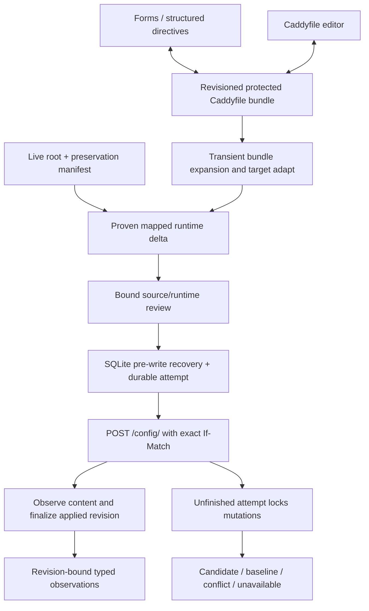
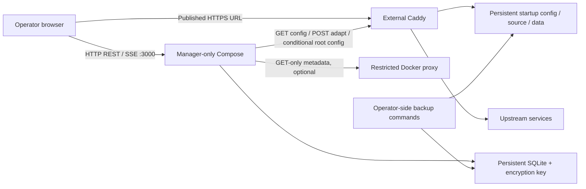

# Architecture Diagrams — Caddy Orchestrator

The [spine](../../planning-artifacts/architecture/architecture-caddy-orchestrator-2026-10-17/ARCHITECTURE-SPINE.md) owns stable AD rules; its [companion](../../planning-artifacts/architecture/architecture-caddy-orchestrator-2026-10-17/configuration-contracts.md) owns the shared record/API model. Diagrams summarize those contracts and do not supersede them.

No transaction spans SQLite and Caddy. Restore uses the same reviewed guarded attempt protocol, generating a new applied revision. Manager-network, direct-upstream and client observations are distinct targets/vantages. No automatic source inversion or remote filesystem write is implied.
